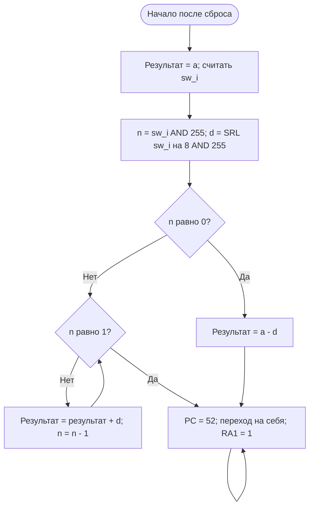

# Вариант 28: арифметическая прогрессия

Готовая программа находится в **individual/program.mem**. Это другая программа,
чем демонстрационный счётчик в **mem/program.mem**. В проект нужно подключать
только один файл с именем program.mem. Скрипты progression_* выбирают индивидуальный.
Код процессора не меняется: меняется программа в его памяти инструкций.


## Какие файлы нужны

- `program_binary.txt` — исходная двоичная программа с комментариями.
- `program.mem` — готовая программа в hex для памяти процессора.
- `tb_progression_demo.sv` — короткая демонстрация примера из задания.
- `tb_progression.sv` — расширенная проверка на 583 случаях.
- `README.md` — алгоритм, запуск и порядок защиты.

`cyberconverter.cpp` из методички переводит двоичные строки в hex.
Готовый `program.mem` уже получен и проверен, поэтому для запуска Vivado
конвертер не требуется. Если редактируешь двоичный исходник, из папки
`lab4/individual` можно пересобрать его оригинальным конвертером:

```sh
c++ -std=c++11 "../../APS/Labs/04. Primitive programmable device/Индивидуальное задание/cyberconverter.cpp" -o /tmp/cyberconverter
/tmp/cyberconverter program_binary.txt program.mem
```

Этот путь предполагает исходное расположение папок APS и lab4 рядом.
На другом компьютере укажи путь к `cyberconverter.cpp` из методички.

Проверено 30.10.2026: конвертер даёт те же 128 слов ROM; модель инструкций
прошла все 65536 входов; RTL процессора в Verilator прошёл 583 случая.
Для повторной проверки RTL в Vivado используй тесты ниже.

## Что вычисляем

`a_n = a + (n-1)*d`, где `d=sw_i[15:8]`, `n=sw_i[7:0]`.
Первый член **a=1** задан первой машинной командой. По README курса `a` — число,
заданное в программе; это не дополнительный вход и не отдельный переключатель.

Для примера: a=1, d=2, n=3. Члены: 1, 3, **5**.
На входе SW=0x0203, на выходе ожидаем 5=0x00000005.

При n>=1 начинаем с a и прибавляем d ровно n-1 раз.
Нулевого члена при нумерации с a1 обычно не задают. Здесь случай n=0 явно
обработан как продолжение формулы назад: **a0=a-d**. Если преподаватель требует
другое поведение для n=0, это отдельное соглашение, не определённое примером задания.

## Алгоритм и блок-схема

Умножение заменено последовательным прибавлением разности прогрессии.



При `n>=1` цикл делает `n-1` сложений. После k итераций результат равен
`a+k*d`, а оставшийся номер равен `n_исходное-k`. Поэтому при оставшемся
номере 1 результат равен требуемому `a+(n_исходное-1)*d`.

Для `n=0` в условии не определён отдельный ожидаемый результат. В реализации
принято продолжение формулы назад: `a_0=a-d`. Это явно выбранное соглашение.
Операции выполняются в 32 битах. При a=1 и n>=1 результат лежит от 1 до 64771;
в случае n=0 отрицательный результат представлен дополнительным кодом.

## Какие регистры используем

| Регистр | Содержимое |
|---|---|
| r0 | Постоянный ноль |
| r1 | Результат, изначально a=1 |
| r2 | Исходный вход sw_i со знаковым расширением |
| r3 | Маска 255, то есть 0xFF |
| r4 | n; в цикле уменьшается до 1 |
| r5 | 8 — величина сдвига |
| r6 | Неотрицательный шаг d |
| r7 | 1 — для сравнения и уменьшения n |

Отрицательный знаково расширенный r2 не мешает: `n = r2 & 255`,
`d = (r2 >> 8) & 255`. Вторая маска обязательна для d>=128.

## Программа по адресам

Двоичные коды с комментариями находятся в **program_binary.txt**,
соответствующие шестнадцатеричные слова — в **program.mem**.

| PC, десятичный | PC, hex | Действие |
|---:|---:|---|
| 0 | 00 | r1 = a |
| 4 | 04 | r2 = sw_i |
| 8 | 08 | r3 = 255 |
| 12 | 0C | r4 = r2 AND r3 — выделить n |
| 16 | 10 | r5 = 8 |
| 20 | 14 | r6 = r2 SRL r5 |
| 24 | 18 | r6 = r6 AND r3 — выделить d |
| 28 | 1C | r7 = 1 |
| 32 | 20 | Если r4==0, PC+=6*4, на адрес 56 |
| 36 | 24 | Если r4==1, PC+=4*4, на адрес 52 |
| 40 | 28 | r1 = r1 + r6 |
| 44 | 2C | r4 = r4 - r7 |
| 48 | 30 | PC+=(-3)*4, назад на адрес 36 |
| 52 | 34 | Переход на себя, RA1=1: out_o=r1 |
| 56 | 38 | Только для n=0: r1 = r1 - r6 |
| 60 | 3C | PC+=(-2)*4, на адрес 52 |

После 16 рабочих команд файл дополнен до размера ROM повторениями финальной
команды. Это не дополнительные шаги алгоритма: штатное выполнение остаётся на PC=52.

## Запуск симуляции в Vivado

1. Перенеси всю папку lab4 (либо распакуй lab4_variant28.zip) на компьютер,
   где работает Vivado. Для X2Go это удалённый сервер.
2. Сохрани изменения и выбери **File → Close Project**.
3. В Tcl Console выполни, заменив путь на путь **на сервере**:

```tcl
source /home/ТВОЙ_ЛОГИН/lab4/scripts/progression_sim.tcl
```

В архиве проект лежит в папке `lab4`.
Скрипт создаёт отдельный проект build_progression_sim, подключает нужный program.mem
и тест **tb_progression_demo**. Исходный проект-счётчик не меняет.
Не помещай свои исходники в служебные папки build_progression_*: они пересоздаются.

Ожидаем: **PASS: d=2 n=3 OUT=5 PC=52** при a=1.
На диаграмме финальный PC=52 (hex 34), out=5, jump=1, second_term=0.
Чтобы рассмотреть начало, после запуска:

```tcl
restart
run 200 ns
```

Первые команды идут PC=0,4,8,12,...,32, затем цикл
36→40→44→48→36. В конце 36→52 и PC остаётся 52.
Финальный PC=52 появляется в 185 нс при периоде такта 10 нс.

Расширенный тест: закрой симуляцию, в Simulation Sources назначь **tb_progression**
как Set as Top и запусти Run Behavioral Simulation → Run All.
Ожидаем **PASS: arithmetic progression, 583 cases, a=1**.
Первый тест из прежнего проекта, lab_04_tb_CYBERcobra, проверяет старый счётчик
до 264 и для индивидуальной программы не подходит.

## Создание проекта для платы

Для платы **Nexys A7 100T**, как в методичке. Модуль обвязки и XDC уже находятся
в папке board, дополнительно копировать APS не нужно.

1. Сохрани изменения и закрой текущий проект: **File → Close Project**.
2. Выполни в Tcl Console:

```tcl
source /home/ТВОЙ_ЛОГИН/lab4/scripts/progression_board.tcl
```

3. Откроется отдельный проект **progression_board**:
   - Design Top: **nexys_CYBERcobra**;
   - память: **individual/program.mem**;
   - ограничения: **board/nexys_a7_100t.xdc**.
4. Нажми **Generate Bitstream**, дождись успешного завершения.
5. **Open Hardware Manager → Open Target → Auto Connect**.
6. **Program Device**. Выбери прошивку именно progression_board:
   `build_progression_board/progression_board.runs/impl_1/nexys_CYBERcobra.bit`.
7. Нажми **Program**.

При удалённом запуске Vivado должен видеть аппаратный сервер с платой. Если плата
уже прошивалась у тебя в этой сессии, используй тот же аппаратный target.
Здесь на Mac битстрим не собирался и физическая плата не программировалась:
проверены SystemVerilog-моделирование процессора и машинная программа.

**После замены program.mem нужно пересобрать прошивку.** Простая смена SW не меняет
программу в ROM. Если Vivado считает старую сборку актуальной: правой кнопкой
на synth_1 в Design Runs → Reset Run, затем Generate Bitstream и Program Device.

## Демонстрация на плате: d=2, n=3, a=1

1. Выставь **SW=0x0203**:
   - **SW9=1, SW1=1, SW0=1**;
   - остальные SW=0.
   Старшие 8 переключателей задают d=2, младшие — n=3.
2. Удерживай **CPU_RESET**, нажми и отпусти **BTND**, затем отпусти CPU_RESET.
   Это отдельное нажатие для сброса PC на 0.
3. Сделай **18 обычных нажатий BTND**. При a=1 получишь финальный результат 5.
4. На блоке **PC** должно быть **34** (hex, это десятичное 52),
   на блоке **out** — **05**, операция **JUMP**.
   Светятся **LED2 и LED0**: двоичное 0000 0000 0000 0101.
5. Последующие нажатия ничего не меняют: программа повторяет переход на себя.

Таблица для контроля. Номер нажатия считается ПОСЛЕ отдельного сброса.
PC на индикаторе — адрес команды, которая будет выполнена СЛЕДУЮЩИМ нажатием.

| Нажатие | Выполнено | Новый PC, hex | Важное изменение |
|---:|---|---:|---|
| 0 | Сброс | 00 | Начало программы |
| 1 | LI r1,a | 04 | r1=1 |
| 2 | IN r2 | 08 | r2=0x0203 |
| 3 | LI r3,255 | 0C | r3=255 |
| 4 | AND: выделить n | 10 | r4=3 |
| 5 | LI r5,8 | 14 | r5=8 |
| 6 | SRL: сдвинуть вход | 18 | r6=2 |
| 7 | AND: маска d | 1C | r6=2 |
| 8 | LI r7,1 | 20 | r7=1 |
| 9 | Проверить n==0 | 24 | Не равно, идём дальше |
| 10 | Проверить n==1 | 28 | Не равно, идём дальше |
| 11 | ADD результата и d | 2C | r1=3 |
| 12 | SUB оставшегося n | 30 | r4=2 |
| 13 | JUMP назад | 24 | Возврат к проверке |
| 14 | Проверить n==1 | 28 | Не равно |
| 15 | ADD результата и d | 2C | r1=5 |
| 16 | SUB оставшегося n | 30 | r4=1 |
| 17 | JUMP назад | 24 | Возврат к проверке |
| 18 | Проверить n==1 | 34 | Равно, переход в финал; out=5 |
| 19 и далее | JUMP на себя | 34 | Результат сохраняется |

Во время исполнения out может показывать промежуточные числа, так как он связан
с RA1 ТЕКУЩЕЙ команды. Итог считываем на финальном JUMP при PC=0x34.

Чтобы проверить другой вход, поменяй SW и повтори сброс + выполнение.
Вход считывается программой один раз на втором рабочем нажатии.
Для n>=1 нужно 10+4*(n-1) рабочих нажатий, поэтому для показа удобнее n=1,2,3.

| SW, hex | d | n | Результат при a=1 | Рабочих нажатий |
|---|---:|---:|---|---:|
| 0201 | 2 | 1 | 1 (0x0001) | 10 |
| 0202 | 2 | 2 | 3 (0x0003) | 14 |
| 0203 | 2 | 3 | 5 (0x0005) | 18 |
| 0304 | 3 | 4 | 10 (0x000A) | 22 |
| 0003 | 0 | 3 | 1 (0x0001) | 18 |
| 8003 | 128 | 3 | 257 (0x0101) | 18 |

Индикатор out показывает только младшие 8 бит (для 257 покажет 01),
светодиоды — младшие 16 бит (для 257 светятся LED8 и LED0).

## Что сказать преподавателю

«Использую a_n=a+(n-1)d. a задано константой в программе. Считываю переключатели,
маской 255 выделяю n, сдвигом вправо на 8 и маской выделяю d. Начинаю результат
с a. Пока n не равно 1, прибавляю d и уменьшаю n на единицу. В финале делаю
переход на себя с RA1=1, чтобы на out_o было содержимое регистра результата r1.
Для d=2,n=3 программа дважды прибавляет 2 к 1 и получает 5».

## Изменение a

В первой команде `program_binary.txt` замени 23-битную константу между
`0 0 00` и `00001`, затем выполни конвертацию, описанную выше.
Допустимо a от -4194304 до 4194303; отрицательные числа кодируются
23-битным дополнительным кодом. После изменения перезапусти симуляцию
и пересобери битстрим. Тесты читают a из первой команды автоматически.
Примеры в этой инструкции даны для a=1.
